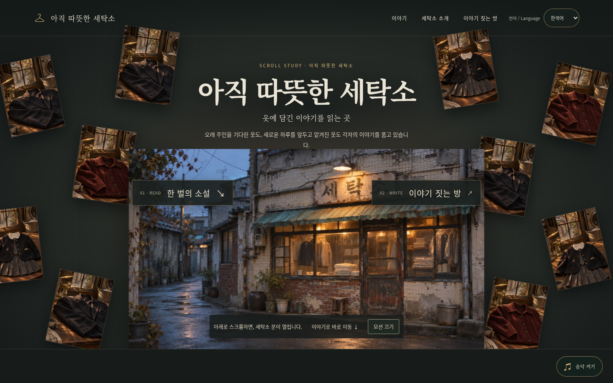
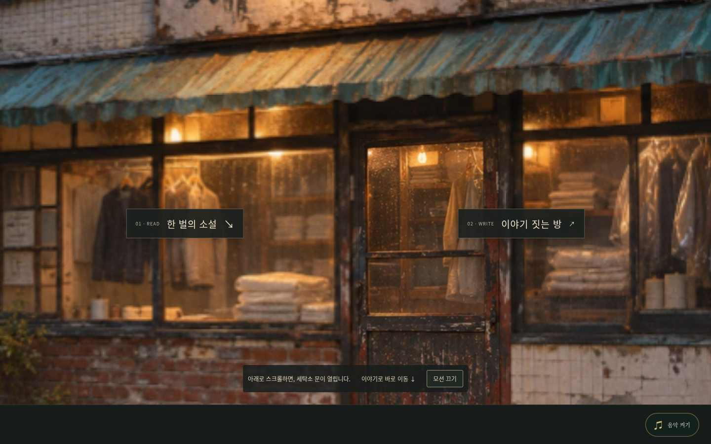
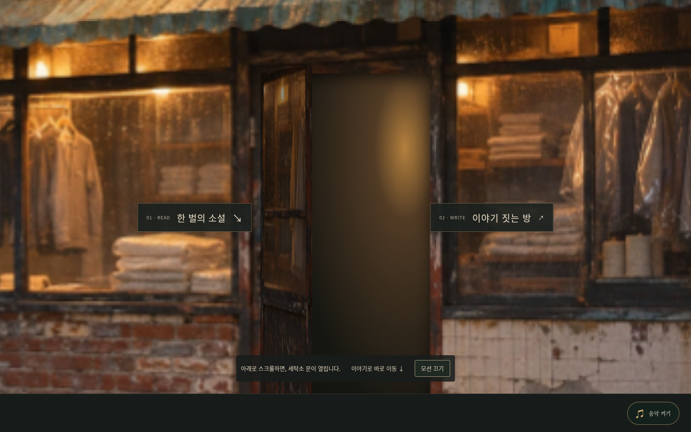
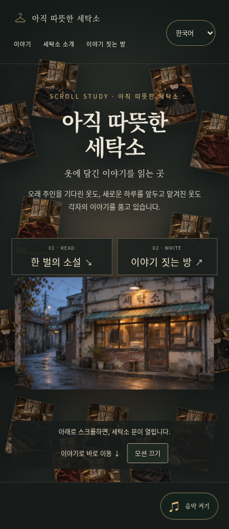
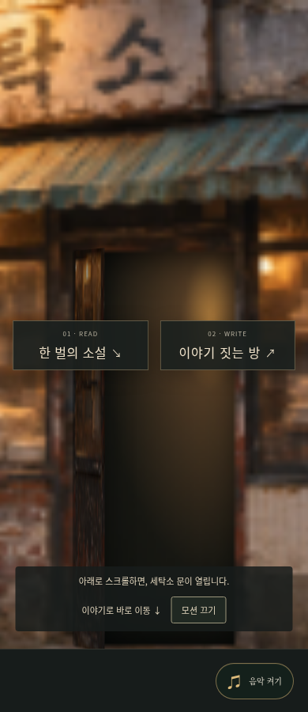

# 세탁소 스크롤 모션 시안

기존 메인 페이지와 분리한 시안입니다. `dist/motion-preview.html`에서 확인할 수 있습니다. 운영 사이트에는 배포하지 않았습니다.

기존 세 옷 사진을 반복·구도 변주한 **14개 이미지 조각** → 세탁소 전경 확대 → 원본의 낡은 문 열림 → 아래 **한 벌의 소설** 순서입니다. 시간에 맞춰 기다리는 인트로가 아니라 스크롤 위치에 연결됩니다. 위로 스크롤하면 역순으로 돌아가며, 자동으로 스크롤하거나 독자의 포커스를 옮기지 않습니다.

두 카테고리는 실제 링크입니다. ‘한 벌의 소설’은 이야기 목록, ‘이야기 짓는 방’은 기존 작업실로 연결됩니다. 바로 이동, 모션 끄기, OS 모션 줄이기, JavaScript 없는 정적 탐색을 제공합니다. 음악 버튼은 오른쪽 하단에 있습니다.

## 화면 미리보기

시작 화면:

전경 확대:

문 열림:

모바일:

## 로컬 실행

저장소 루트에서 `python3 -m http.server 8000 --directory dist` 실행 후 `http://localhost:8000/motion-preview.html`을 엽니다. GitHub 파일 화면 자체는 HTML 모션을 실행하지 않습니다.

## 검증

`node tests/motion-preview.cjs`: 설치된 Chromium/Playwright에서 1440·390·320px, 스크롤 단계, 문 회전, 세 이야기 딥링크와 뒤로가기, 영어 전환, 모션 끄기·OS 설정, 키보드 바로 이동, 음악 컨트롤 위치, JavaScript 없는 화면 검증 통과. 각 화면 높이는 900px이며 실제 모바일 기기의 GPU 성능 측정은 아닙니다.

`node tests/audio.cjs`: 기존 메인 오디오 회귀 검사, 데스크톱/모바일 × Web Audio/미디어 폴백 4조합 통과. 시안은 같은 기존 오디오 스크립트와 파일을 사용합니다.

## 표현 한계와 보존 범위

- 문은 원본 전경 사진의 같은 위치를 CSS 배경으로 분리해 회전시키는 2.5D 효과입니다. 안쪽은 따뜻한 어두운 빛으로 표현한 시안이며 실제 촬영된 내부가 아닙니다. 최종 품질을 높이려면 같은 문 구도의 고해상도 전경과 내부/문 분리 소재가 필요합니다.
- 기존 세 옷 사진을 반복 사용했습니다. 14개의 서로 다른 새 옷이나 배경 제거된 의상 소재를 만든 것은 아닙니다.
- 전달된 참고 영상의 흐름 설명을 바탕으로 제작했습니다. 이 작업에서는 영상 파일 자체를 재생·분석하지 않았습니다.
- 원본 이미지·이야기 본문·낭독 파일을 수정하지 않았습니다. 할머니/유치원복 새 음원은 여전히 통합되지 않았습니다.
- 이 커밋은 별도 시안·검증 코드·스크린샷만 포함합니다. 진행 중인 작업실 변경과 Claude 서버 연결 준비 파일은 기존 로컬 상태에 보존하며 이번 모션 푸시에 섞지 않았습니다. 시안은 메인 복사본이므로 본문이 바뀔 때 동기화해야 합니다.
